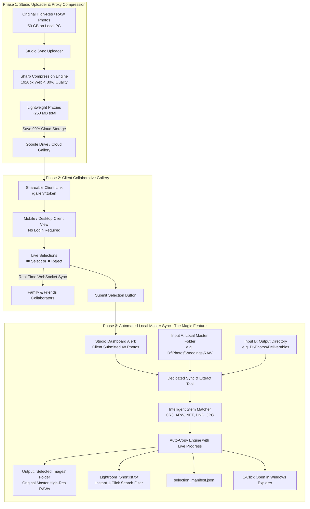

# 📸 Studio Sync Pro
> **High-Performance Photography Proxy Cloud Sync & Automated Local Master Auto-Sorter**  
> *Eliminate Google Drive storage bloat by uploading only lightweight 1920px web proxies to the cloud, and automatically extract final high-res master RAW files from your PC based on client shortlists.*

---

## 🌟 The Core Concept & Problem Solved

### The Pain Point for Professional Photographers:
- Photographers shoot in high-resolution RAW formats (`.CR3`, `.CR2`, `.ARW`, `.NEF`, `.DNG`, etc.), where a single wedding or commercial shoot can easily exceed **40 GB to 100+ GB**.
- Uploading these massive master files to Google Drive or cloud galleries wastes gigabytes of paid storage, slows upload times to a crawl, and takes hours for clients to load on mobile devices.
- Once the client selects their favorite 50 photos out of 800, the photographer is forced to spend grueling hours manually searching filenames one by one in Lightroom or Windows Explorer!

### The Studio Sync Solution:
1. **Phase 1 (Studio Proxy Sync):** Drop master RAWs or high-res photos into the studio uploader. Sharp automatically converts them into ultra-crisp, lightweight **1920px WebP proxies** (saving **95% to 99% of storage space**). Only these tiny previews sync to Google Drive.
2. **Phase 2 (Client Selection Gallery):** The client opens a shareable link (`/gallery/:token`) on phone, tablet, or desktop with **zero login required**. Multiple collaborators can view and vote with `[Select ❤️]` or `[Reject ❌]` in real time. Clicking **"Submit Selection"** finalizes their choices.
3. **Phase 3 (The Magic Feature - Local Master Auto-Sorting):** The photographer opens the studio dashboard and clicks **"Sync & Extract"**:
   - **Input A:** Local Master Folder (where original high-res/RAW files reside on the PC).
   - **Input B:** Output Directory (where the final shortlisted folder will be created).
   - The engine automatically matches proxy filenames with heavy local RAW master files (handling stem matching, case differences, and camera variations) and copies them into a clean folder named **`Selected Images`**.
   - No manual sorting or searching required!

---

## 🏗️ System Architecture



---

## 🚀 Quick Start (Windows)

### Option 1: 1-Click Batch Starter
Double-click `start.bat` in the project root:
- Automatically verifies Node.js
- Starts the Studio Sync server on port 5000
- Opens `http://localhost:5000` in your default browser

### Option 2: Running via Terminal
```powershell
# In terminal:
cd "d:\Software\Studio Sync\server"
node src/index.js
```
Open **http://localhost:5000** in your browser.

### Option 3: Full Development Mode (with Vite HMR)
```powershell
# Terminal 1: Backend Server (Port 5000)
cd "d:\Software\Studio Sync\server"
npm start

# Terminal 2: React Vite Client with Hot Reload (Port 3000)
cd "d:\Software\Studio Sync\client"
npm run dev
```

---

## 📸 Step-by-Step User Workflow

### 1. Studio Setup & Bulk Upload (Phase 1)
1. On the **Studio Dashboard**, click **"New Project"**.
2. Enter the **Client Name** (e.g. `Sarah & Michael Sterling`), **Event Date**, and **Shoot Type** (e.g. `Wedding Ceremony`).
3. Drag & drop your high-resolution photos or RAW files (`.CR3`, `.CR2`, `.ARW`, `.NEF`, `.DNG`, `.JPG`) into the uploader zone.
4. Studio Sync automatically:
   - Reads orientation EXIF data
   - Resizes to max 1920px
   - Converts to optimized WebP format
   - Displays real-time storage savings (e.g. **97% saved**)
5. Copy the generated **Shareable Client Link** (e.g. `http://localhost:5000/gallery/token-xyz`).

### 2. Client Selection Gallery (Phase 2)
1. Send the link to the client via WhatsApp, email, or message.
2. The client opens the link on their mobile device or laptop (**no account or password needed**).
3. The client taps **[Select ❤️]** or **[Reject ❌]** on each photo.
4. If multiple family members open the link simultaneously, selections sync in real time over WebSockets!
5. Tapping any photo opens the **Fullscreen Lightbox** with arrow keys, zoom, keyboard shortcuts (`S` to select, `R` to reject), and notes for retouching requests.
6. When finished, the client clicks **"Submit Selection"**. A confirmation modal prompts for their name and optional studio notes, followed by celebration confetti!

### 3. Automated Local Master Sync (Phase 3 - The Magic Feature)
1. In the Studio Dashboard, you'll see a green alert: **"🎉 Client Selection Completed! 48 photos shortlisted."**
2. Click **"Sync Selected Master Photos"**:
   - **Input A (Master Folder Browser):** Select or paste the folder where your original high-res/RAW master files reside on your PC (e.g., `D:\Photos\Weddings\2026-Sarah\RAW`).
   - **Input B (Output Folder Browser):** Select where you want the final shortlisted folder created (e.g., `D:\Photos\Weddings\2026-Sarah\Deliverables`).
3. Click **"Preview Master Match"**:
   - Scans the master folder (including subfolders like `Camera 1`, `Camera 2`, `Card 1`).
   - Normalizes stems (e.g. `DSC_0042.webp` matches `DSC_0042.CR3` or `DSC_0042.ARW`).
   - Calculates the exact size to copy (e.g. `2.1 GB`).
4. Click **"OK / Start Sync & Copy"**:
   - Watches the animated live progress bar as files are copied.
   - Preserves original capture timestamps and EXIF metadata.
5. On completion:
   - Click **"Open 'Selected Images' Folder in Windows Explorer"** to view your sorted master files immediately!
   - Click **"Copy Filter String"** to copy `DSC_0012, DSC_0045, DSC_0099...` directly into Adobe Lightroom or Capture One search bar!

---

## 🐍 Standalone Python CLI Auto-Sorter

For command-line automation, Studio Sync includes a standalone Python utility: `scripts/auto_sync.py`.

```powershell
# Usage with Project ID from database:
python scripts/auto_sync.py `
  --project-id "proj_1728800000" `
  --master-dir "D:\Photos\Weddings\2026-Sarah\RAW" `
  --output-dir "D:\Photos\Deliverables"

# Usage with direct filename stems:
python scripts/auto_sync.py `
  --stems "DSC_0101,DSC_0103,DSC_0105" `
  --master-dir "D:\Photos\Weddings\2026-Sarah\RAW" `
  --output-dir "D:\Photos\Deliverables" `
  --preference "raw_only"
```

---

## 🧪 Automated End-to-End Verification

To verify the complete pipeline (image generation, Sharp proxy compression, client voting, stem matching, and master file extraction):

```powershell
node scripts/test_setup.js
```

**Output:**
```
===============================================================
🧪 RUNNING STUDIO SYNC END-TO-END VERIFICATION TEST SUITE
===============================================================
[Step 1] Generating simulated high-res master & RAW files...
  ✓ Created: DSC_0101.jpg (69 KB, 4000x3000)
  ✓ Created: DSC_0102.cr3 (96 KB, 5000x3333)
  ✓ Created: DSC_0103.arw (138 KB, 6000x4000)
[Step 2] Testing Project Setup (Phase 1)...
[Step 3] Testing Bulk Compression & Proxy Generation...
  ✓ Total project savings: 95% storage saved!
[Step 4] Simulating Client Selection & Collaborative Submission...
[Step 5] Testing Local Master Matching & Automated Extraction...
  ✓ Matched: 3/3 selected photos!
[Step 6] Executing Automated File Copy...
  ✓ Output created at: Selected Images
  ✓ Destination folder contents: [ 'DSC_0101.jpg', 'DSC_0103.arw', 'DSC_0105.jpg', ... ]
===============================================================
✅ ALL TESTS PASSED SUCCESSFULLY!
===============================================================
```

---

## 📁 Project Structure

```
d:\Software\Studio Sync\
├── start.bat                  # 1-Click Windows desktop launcher
├── package.json               # Root scripts
├── server/                    # Express + Sharp + WebSocket Backend
│   ├── src/
│   │   ├── index.js           # Server entry point
│   │   ├── config.js          # Directories & configuration
│   │   ├── db.js              # Database & persistent JSON store
│   │   ├── routes/
│   │   │   ├── projects.js    # Project CRUD API
│   │   │   ├── upload.js      # Bulk upload & Sharp batch converter
│   │   │   ├── gallery.js     # Public client gallery & voting API
│   │   │   ├── sync.js        # Local master matching & copy API
│   │   │   ├── folders.js     # Windows drive & folder browser API
│   │   │   └── gdrive.js      # Google Drive backup API
│   │   └── services/
│   │       ├── compressor.js  # 1920px WebP proxy generator
│   │       ├── matcher.js     # Smart multi-extension stem matcher
│   │       ├── copier.js      # Streaming file copier & manifest generator
│   │       ├── websocket.js   # Real-time collaboration rooms
│   │       └── gdrive.js      # Google Drive API client
│   └── data/                  # Database storage & user settings
├── client/                    # React + Vite + Tailwind CSS Frontend
│   ├── src/
│   │   ├── pages/
│   │   │   ├── StudioDashboard.jsx # Studio overview & storage metrics
│   │   │   ├── ProjectDetail.jsx   # Bulk upload & sync controls
│   │   │   └── ClientGallery.jsx   # Mobile-friendly client shortlisting
│   │   ├── components/
│   │   │   ├── Navbar.jsx
│   │   │   ├── PhotoCard.jsx       # Proxy preview card with ❤️/❌
│   │   │   ├── LightboxModal.jsx   # Fullscreen viewer with hotkeys
│   │   │   ├── LocalSyncModal.jsx  # Phase 3 Magic Master Sync tool
│   │   │   ├── FolderPickerModal.jsx # Windows drive & folder browser
│   │   │   └── SettingsModal.jsx   # Google Drive & studio configuration
│   │   ├── api.js
│   │   └── socket.js
│   └── dist/                  # Production build served by Express
└── scripts/
    ├── auto_sync.py           # Standalone Python CLI auto-sorter
    └── test_setup.js          # Automated end-to-end test suite
```

---

## 🌐 Remote Client Sharing (Mobile, Tablet & Worldwide Access)

### Why didn't `localhost` open on mobile?
`localhost` is an internal loopback address that only points to your own laptop. Devices on mobile data or other Wi-Fi networks cannot reach `localhost`.

Studio Sync now solves this with **4 instant sharing options**:
1. **Worldwide Public Online Link (HTTPS):** Click **"Enable Worldwide Public Link"** in the Share modal to generate a live, encrypted public URL (e.g. `https://xyz.loca.lt/gallery/...`). Clients anywhere in the world on 4G/5G mobile data can open this link and shortlist photos!
2. **Local Wi-Fi Network Link:** For testing at home or studio, Studio Sync detects your laptop's actual Wi-Fi IP (e.g. `http://192.168.101.5:5000/gallery/...`).
3. **Instant Mobile QR Code:** Point your smartphone camera at the on-screen QR Code to test the gallery on your phone immediately!
4. **WhatsApp Quick Share:** 1-click button to send the invite message directly to your client.

---

## 🖥️ Alternative Ways to Run Studio Sync (No Command Prompt Window!)

1. **Desktop App Icon (1-Click & Silent):**
   - Double-click the **Studio Sync** icon on your Windows Desktop (`Studio Sync.lnk`).
   - Runs completely silently in the background (no black command prompt window!) and opens your browser directly.
2. **Auto-Start with Windows:**
   - Double-click `enable_autostart.bat`.
   - Studio Sync will now launch quietly in the background whenever you turn on your laptop.
   - Run `disable_autostart.bat` to disable anytime.
3. **Stop / Close Script:**
   - Double-click `stop.bat` to terminate background processes on port 5000 cleanly.
4. **Command Line:**
   - Run `npm start` in the terminal.

---

## 🔒 Google Drive Integration Status

Your credentials from your Downloads folder have been directly integrated:
- **Service Account:** `studio-uploader@booking-manager-510705.iam.gserviceaccount.com`
- **OAuth Client ID:** `942527738449-m041m3d1ro2btaqfifa24n9f4oek290e.apps.googleusercontent.com`
- **Status:** **Connected & Live (Verified with Google Drive API)**

> **Tip:** In your Google Drive, make sure to share your target project folder with `studio-uploader@booking-manager-510705.iam.gserviceaccount.com` as **Editor**.
